# Decaynet

**A time-machine map and community wiki for any place's history.** It was built for Gary, Indiana and the Calumet Region (the demo data), but you can run one for Detroit, a whole country, or the world.
Drag a slider from 1890 to today and watch streets get laid out, buildings rise, change hands, empty out, burn and disappear. Every place, person, business, photo and event is a wiki page, and every fact on it has a date, a confidence level and a source.

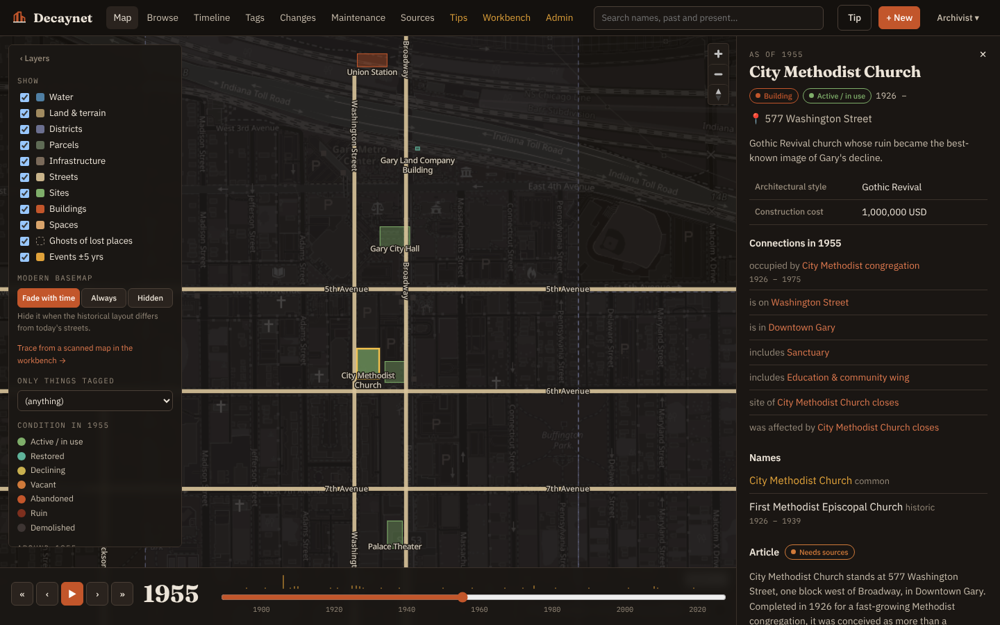

Built with **SvelteKit 2 / Svelte 5**, **Supabase** (Postgres 17 + PostGIS, Auth, Storage) and **MapLibre GL**. Licensed **AGPL-3.0-or-later**.

---

## Contents

- [What it does](#what-it-does)
- [Quick start with Docker](#quick-start-with-docker)
- [Local development](#local-development)
- [Starting your own region](#starting-your-own-region)
- [Guides](#guides)
  - [Reading the map](#reading-the-map)
  - [Adding and editing pages](#adding-and-editing-pages)
  - [Private pages (drafts)](#private-pages-drafts)
  - [Buildings, spaces and tenants](#buildings-spaces-and-tenants)
  - [Tracing from a scanned map (workbench)](#tracing-from-a-scanned-map-workbench)
  - [When a whole area's layout changed](#when-a-whole-areas-layout-changed)
  - [Importing GIS data](#importing-gis-data)
  - [Starter pages from OpenHistoricalMap & Wikidata](#starter-pages-from-openhistoricalmap--wikidata)
  - [Anonymous tips](#anonymous-tips)
  - [Administration](#administration)
  - [Keeping quality up](#keeping-quality-up)
- [How the data model works](#how-the-data-model-works)
- [Configuration reference](#configuration-reference)
- [Project layout](#project-layout)
- [About the demo data](#about-the-demo-data)
- [Roadmap & contributing](#roadmap--contributing)
- [License](#license)

---

## What it does

| | |
|---|---|
| 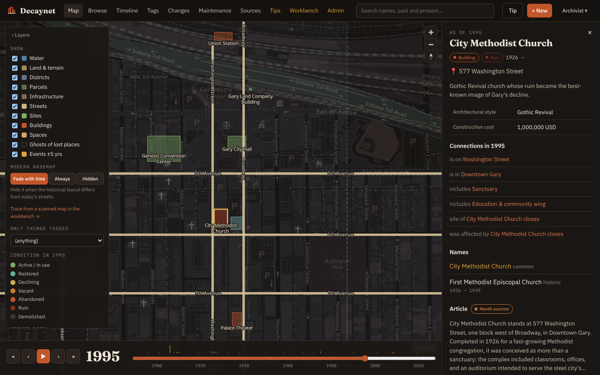 | **Time machine.** Everything on the map is folded to the year on the slider: names, shapes, condition (active → vacant → abandoned → ruin → demolished), occupants and nearby events. The modern basemap fades as you go back. |
| 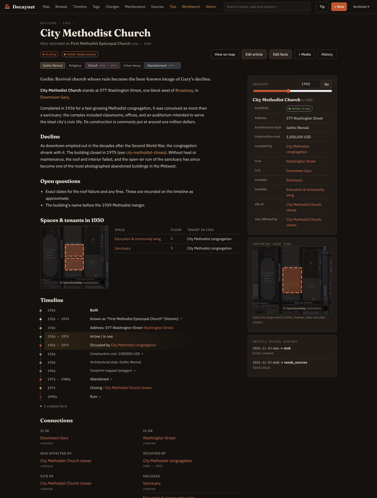 | **A wiki page for everything**, with prose, a dated timeline of every fact, connections, tags, spaces and tenants, photos, footnoted sources and a "snapshot as of year X" box. |
| 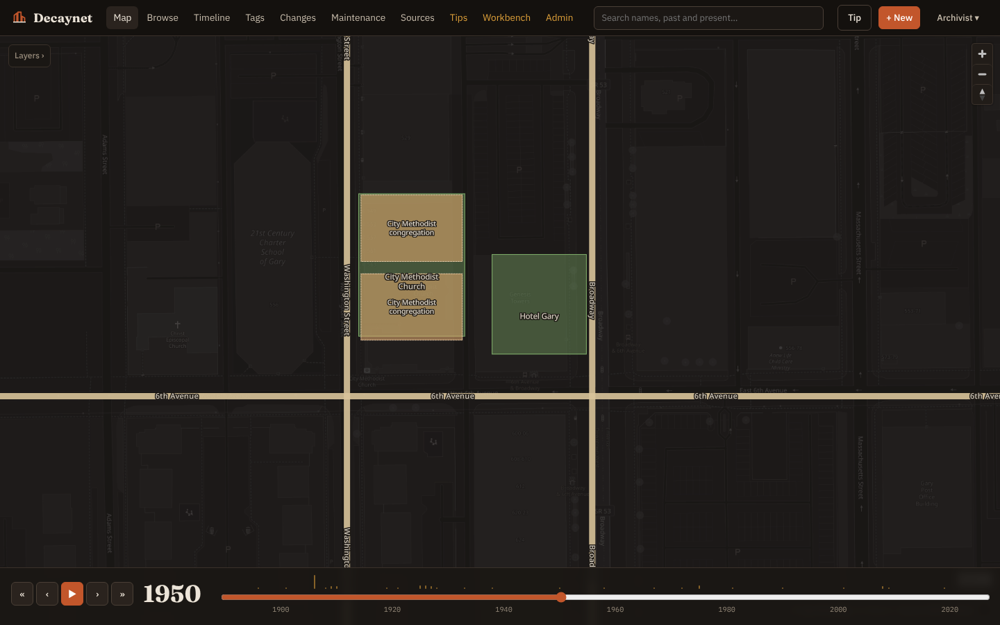 | **Real building footprints** with **spaces inside them** (storefronts, suites, halls). Tenants occupy spaces over time, and at high zoom the map labels each space with who was there that year. |
| 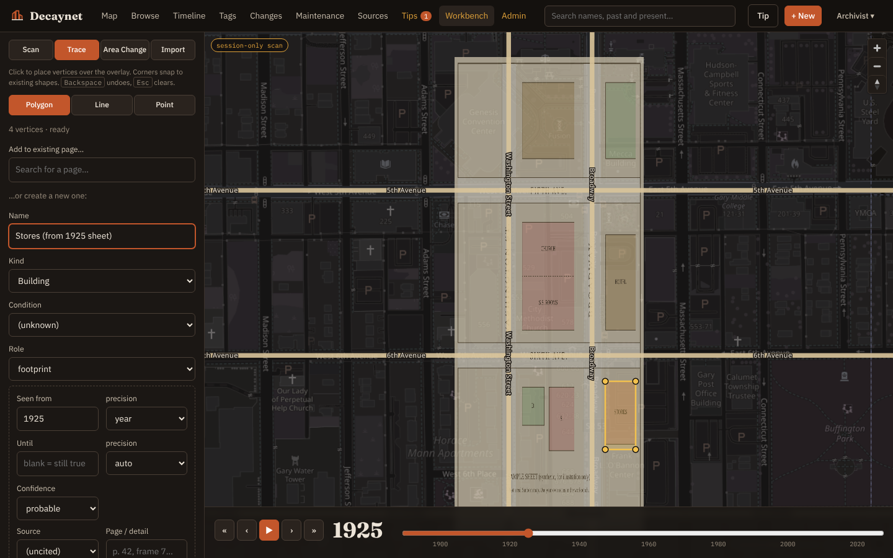 | **Editor workbench.** Pin a scanned Sanborn sheet over the map for the session, compare it with the data, and trace footprints and streets from it. Also bulk tools for area changes and GeoJSON import. |
| 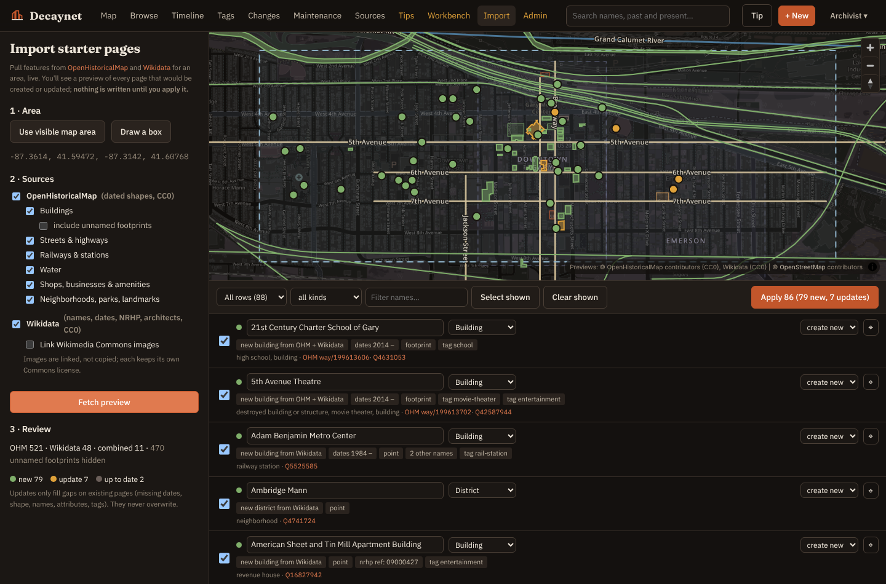 | **Live import from OpenHistoricalMap and Wikidata.** Pick an area, fetch, and review a preview of every page that would be created or filled in before anything is written. |
| 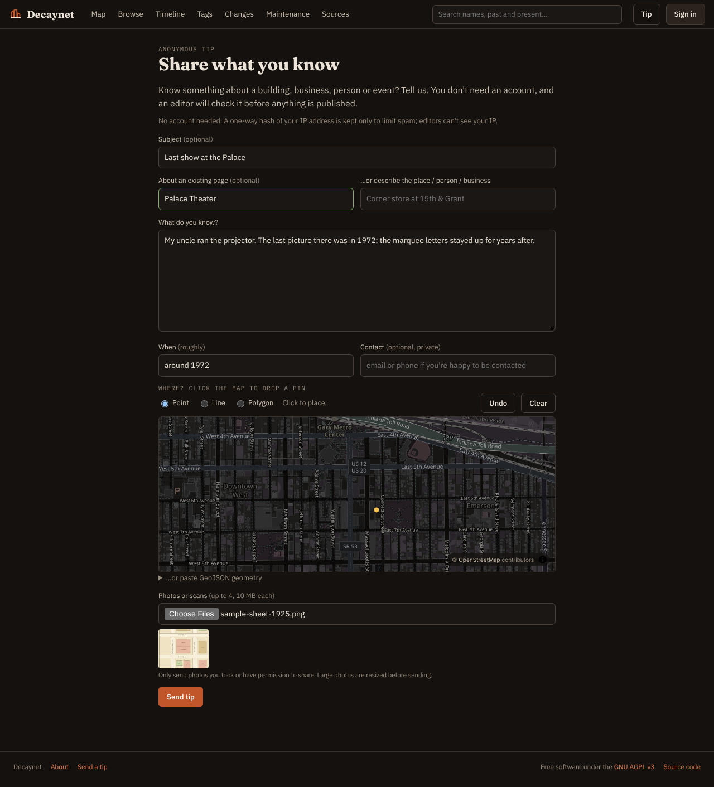 | **Anonymous tips.** Guests can send what they know, with optional photos and a map pin. Optional captcha, IP policy and rate limiting; editors review tips in a queue. |

Also included:
- tags with sub-traits (*Business type › Food & drink › Restaurant › Soul food*)
- article status tracked over time
- recent changes and full history
- a roles × permissions matrix
- site settings editable in the browser
- maintenance queues computed from the data

---

## Quick start with Docker

The default `docker-compose.yml` is **self-contained**: it runs Decaynet *and* a self-hosted Supabase (Postgres 17 + PostGIS, Auth, REST and Storage behind the Kong API gateway). It uses prebuilt images (`ghcr.io/cthulhuonice/decaynet`, `…/decaynet-migrate`, published by CI from `main`) and needs **no bind mounts, no build step and no extra files**, so it works the same from the command line or as a **Portainer** stack.

### 1. Generate secrets (once per site)

Run either of these, or open [`docs/generate-secrets.html`](docs/generate-secrets.html) in a browser (works offline):

```bash
docker run --rm ghcr.io/cthulhuonice/decaynet:latest generate-secrets
# or, from a checkout:  node docker/generate-secrets.mjs
```

The output is `POSTGRES_PASSWORD`, `JWT_SECRET`, `ANON_KEY` and `SERVICE_ROLE_KEY` lines. Keep them private: the service-role key bypasses all access rules. Keep a copy too, because changing them later means resetting the database volume.

### 2a. Deploy with Portainer

1. **Stacks → Add stack**, name it e.g. `decaynet`.
2. Choose either:
   - **Repository:** URL `https://github.com/CthulhuOnIce/Decaynet`, reference `refs/heads/main`, compose path `docker-compose.yml`. Portainer can re-pull and redeploy on updates.
   - **Web editor:** paste the contents of [`docker-compose.yml`](docker-compose.yml).
3. **Environment variables → Advanced mode**, then paste the secrets plus:
   ```
   ORIGIN=https://history.example.org          # public URL of the site (app, port 3000)
   SUPABASE_PUBLIC_URL=https://api.history.example.org   # public URL of Supabase (kong, port 8000)
   SEED=0                                      # 1 = load the Gary, Indiana demo
   ADMIN_EMAIL=you@example.org                 # optional: creates the first admin on start
   ADMIN_PASSWORD=a-long-password              #   (leave both out to use the setup wizard)
   ```
   For a quick local try, `http://<server-ip>:3000` and `http://<server-ip>:8000` work too.
4. **Deploy the stack.** On first boot Postgres initialises (up to a few minutes on small machines), then Auth and Storage start, `migrate` applies the schema and **exits with code 0** (that's expected; it reruns harmlessly on every redeploy), and finally `app` and `kong` go healthy.
5. **Create the first admin**, in one of two ways (see [First admin](#first-admin)):
   - **Environment:** with `ADMIN_EMAIL` and `ADMIN_PASSWORD` set, that account exists as soon as the app starts. Sign in with it.
   - **Setup wizard:** otherwise, opening the site takes you to `/setup`. Enter the **setup code** from the app container's logs (*Containers → decaynet-app → Logs*), create your account and name the site.

### 2b. Deploy from the command line

```bash
mkdir decaynet && cd decaynet
curl -O https://raw.githubusercontent.com/CthulhuOnIce/Decaynet/main/docker-compose.yml
docker run --rm ghcr.io/cthulhuonice/decaynet:latest generate-secrets > .env
docker compose up -d                            # http://localhost:3000
docker compose logs app | grep -A4 "setup code" # the /setup code (or set ADMIN_EMAIL/ADMIN_PASSWORD in .env first)
```

To build the images from a checkout instead of pulling them:
`docker compose -f docker-compose.yml -f docker-compose.build.yml up -d --build`.

### What runs

| Service | What it is | Port | Health |
|---|---|---|---|
| `app` | Decaynet (SvelteKit, adapter-node) | `3000` | `/healthz` (app + database) |
| `kong` | Supabase API gateway; browsers call it for sign-in and uploads | `8000` | `kong health` |
| `db` | Postgres 17 + PostGIS (Supabase image), `db-data` volume | `127.0.0.1:5432` | `pg_isready` |
| `auth` / `storage` | Supabase Auth (GoTrue) / Storage (`storage-data` volume) | internal | HTTP probes |
| `rest` | PostgREST | internal | none: the image has no shell, so it shows as plain "Up" |
| `migrate` | One-shot schema migrator (+ demo seed when `SEED=1`) | | exits 0 when done |

Every health check probes `127.0.0.1`, not `localhost`: inside containers `localhost` can resolve to IPv6 `::1`, where these services don't listen, which used to leave the stack stuck as *unhealthy*. Generous start periods cover slow first boots.

### First admin

A new site has no accounts. Pick whichever suits you:

| Method | How | Good for |
|---|---|---|
| **Environment** | Set `ADMIN_EMAIL` + `ADMIN_PASSWORD` (optional `ADMIN_NAME`). On start, if the site has no admin, that account is created (or, if it already exists, promoted). | Portainer / unattended installs |
| **Setup wizard** | Open the site; it redirects to **`/setup`** until an admin exists. Enter the setup code, create the admin, name the site, then continue to Site settings. | Clicking through it like other wikis |
| **Fixed setup code** | Set `SETUP_TOKEN=…` to choose the code yourself instead of a random one printed in the logs. | Multiple app replicas, scripted installs |

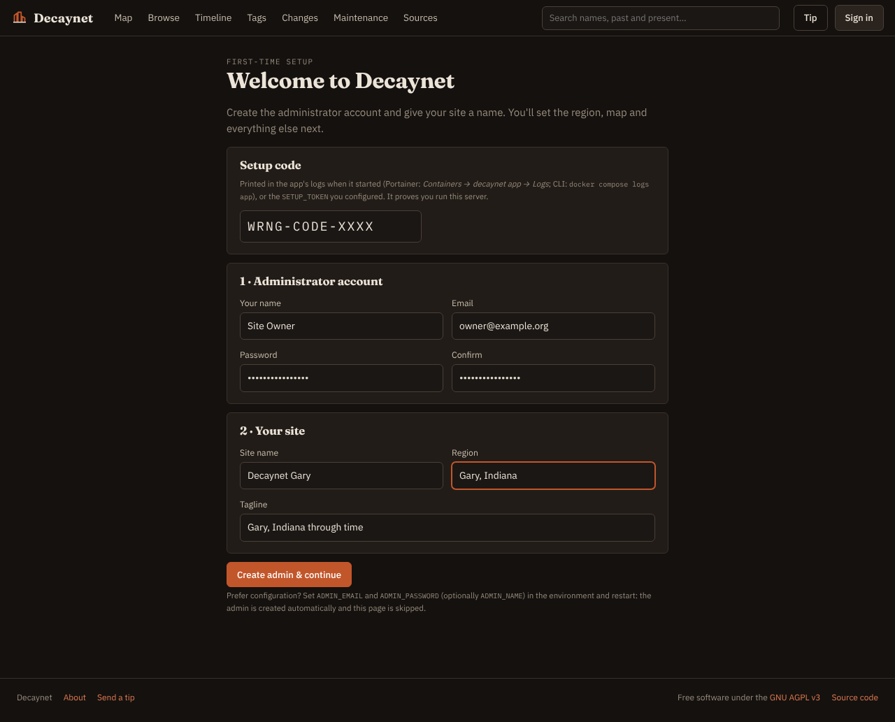

**Why a code?** Without one, whoever reached a fresh site first could make themselves admin. When the app has its service key (always the case in the Docker stack), it also tells the database to stop promoting the first sign-up. So even a direct sign-up through the Auth API before setup only gets the default role. The code is printed on every start until setup is done:

```
================================================================
  Decaynet setup: no admin account yet.
  Open https://history.example.org/setup and enter the setup code:

      K7QD-M2XP-9HTA
================================================================
```

Notes:
- The environment variables only act while the site has **no admin**. Changing `ADMIN_PASSWORD` later does **not** change the password; use *Account → Password*.
- Development without a service key keeps the old behaviour: the first account to sign up becomes admin (and `/setup` is a plain sign-up form).

### Production checklist

- **Hostnames:** put both public URLs behind HTTPS (a reverse proxy such as Traefik, Caddy or Nginx Proxy Manager: `history.example.org` → `app:3000`, `api.history.example.org` → `kong:8000`), then set `ORIGIN` and `SUPABASE_PUBLIC_URL`. Browsers talk to Supabase directly for sign-in and uploads, so it needs its own public URL.
- **Real visitor IPs for tips:** behind a reverse proxy, set `ADDRESS_HEADER=X-Forwarded-For` (and `XFF_DEPTH` to the number of proxies, default 1).
- **Email:** set `SMTP_HOST`, `SMTP_PORT`, `SMTP_USER`, `SMTP_PASS`, `SMTP_ADMIN_EMAIL` and `MAILER_AUTOCONFIRM=false` for confirmation emails, password resets and magic links. Without SMTP, new accounts are confirmed immediately.
- **Backups:** `docker exec <db-container> pg_dump -U postgres postgres > backup.sql`, plus the `storage-data` volume (uploaded media).
- **Pin versions:** set `DECAYNET_IMAGE` / `DECAYNET_MIGRATE_IMAGE` to a tag such as `ghcr.io/cthulhuonice/decaynet:0.2.0` (or `:sha-…`) instead of `latest`.
- **Basemap:** the default modern basemap is the public OpenStreetMap tile server, which is fine for light use. For real traffic, set your own tile URL in Site settings ([OSM tile policy](https://operations.osmfoundation.org/policies/tiles/)).
- **Forks:** CI publishes to `ghcr.io/<your-account>/decaynet`. New GHCR packages may start **private**; make them public under *GitHub → Packages → Package settings*, or log Portainer in to `ghcr.io` (*Registries*). Then point `DECAYNET_IMAGE` / `DECAYNET_MIGRATE_IMAGE` at them.

### Troubleshooting

- **`migrate` shows "Exited (0)"**: normal. Non-zero means the schema failed to apply; check its logs.
- **New features give a 503, or menu entries are missing, and admins see "The database is behind this version of Decaynet"**: the app image was updated but the migrate step didn't run. Re-run it (`docker compose pull && docker compose up -d`, or `docker compose -f docker-compose.external.yml run --rm migrate` with your own Supabase), then reload. `/healthz` shows `schema.have` (newest migration applied) and `schema.need`.
- **`app` unhealthy**: open `http://<host>:3000/healthz`. `db` in the JSON shows the database error, often a wrong `ANON_KEY`/`JWT_SECRET` pair (regenerate all four together).
- **`manifest unknown` when pulling**: the requested tag doesn't exist (yet). Check the tags at *GitHub → Packages → decaynet*, wait for the *Docker images* workflow to finish, or pin a tag that exists, e.g. `DECAYNET_IMAGE=ghcr.io/cthulhuonice/decaynet:sha-1c1e224` and `DECAYNET_MIGRATE_IMAGE=ghcr.io/cthulhuonice/decaynet-migrate:sha-1c1e224`.
- **`unauthorized` / `denied` when pulling `ghcr.io/…`**: the package is private (see *Forks* above). Build locally with `docker-compose.build.yml` meanwhile.
- **Docker Hub rate limits** when building: set `NODE_IMAGE=public.ecr.aws/docker/library/node:22-alpine` and `PG_IMAGE=public.ecr.aws/docker/library/postgres:17-alpine`. Supabase images already come from Supabase's `public.ecr.aws` mirror.
- **TLS-intercepting proxy** when building: `docker build --secret id=ca,src=/path/to/ca.pem .`

### Using Supabase Cloud (or another existing Supabase) instead

`docker-compose.external.yml` runs only the app (and an optional migrator) against a Supabase you already have. It also works in Portainer the same way:

1. In Supabase, copy the project URL, `anon` key and `service_role` key (Project Settings → API), plus the Postgres connection string (Project Settings → Database). Add `https://YOUR-SITE/auth/callback` to Authentication → URL Configuration.
2. Set `PUBLIC_SUPABASE_URL`, `PUBLIC_SUPABASE_ANON_KEY`, `SUPABASE_SERVICE_ROLE_KEY`, `DATABASE_URL` and `ORIGIN`.
3. Run:
   ```bash
   docker compose -f docker-compose.external.yml --profile tools run --rm migrate
   docker compose -f docker-compose.external.yml up -d app
   ```

The migration runner records versions in the same table the Supabase CLI uses, so `supabase db push` and the container can be mixed.

## Local development

Requires Node 20+ and Docker (for the local Supabase stack).

```bash
npm install
npx supabase start          # database, auth, storage + migrations + Gary demo data
                            # (npx supabase db reset --no-seed for an empty site)
cp .env.example .env        # paste URL, anon key and service-role key from `npx supabase status`
npm run dev                 # http://localhost:5173
```

| Command | |
|---|---|
| `npm run dev` | Dev server with hot reload |
| `npm run check` | Type-check (svelte-check) |
| `npm run build && node build` | Production build (adapter-node) |
| `npm run db:reset` | Rebuild the local database from `supabase/migrations` + `supabase/seed.sql` |
| `npm run db:types` | Generate TypeScript types from the database |

---

## Starting your own region

Nothing about Gary is built into the code or the schema; Gary is only the optional demo seed. To run a **Detroit Decaynet**, a country-wide one, or a **global** one:

1. **Start empty.** Leave `SEED=0` (the default), or run `npx supabase db reset --no-seed` in development.
2. **Create the first admin** with the [setup wizard or `ADMIN_EMAIL`/`ADMIN_PASSWORD`](#first-admin). A setup banner then points you to the next steps.
3. **Admin → Site settings → Region & map:**

   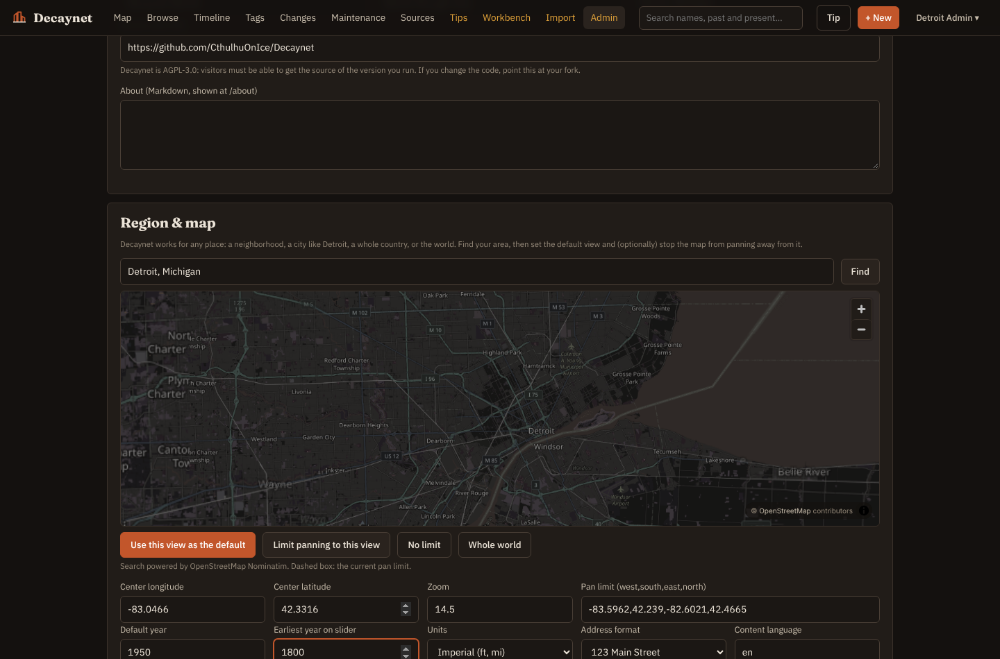

   - **Find a place** (e.g. "Detroit, Michigan"), pan or zoom, then **Use this view as the default**.
   - **Limit panning to this view** to keep visitors in your region, or choose **No limit** / **Whole world** for a global site.
   - Set the **default year** and the **earliest year on the slider** (a global site might use 1500; a city founded in 1701 might use 1700).
   - **Units** (metric / imperial), **address format** (`123 Main Street` or `Hauptstraße 123`) and **content language** (used for Wikidata and OpenHistoricalMap names and for place search).
   - **Site name, tagline, region and About text** appear in the header, page titles and About page.
4. **Admin → Vocabulary** (moderators): rename or add the words your region needs.
   - kinds of page, conditions and their colours, relationship and event types;
   - attributes and their **units and currencies** (e.g. height in m, cost in EUR, a heritage-register number);
   - article statuses and tag facets.

   Entries the code relies on are marked • and can be relabelled but not deleted.

   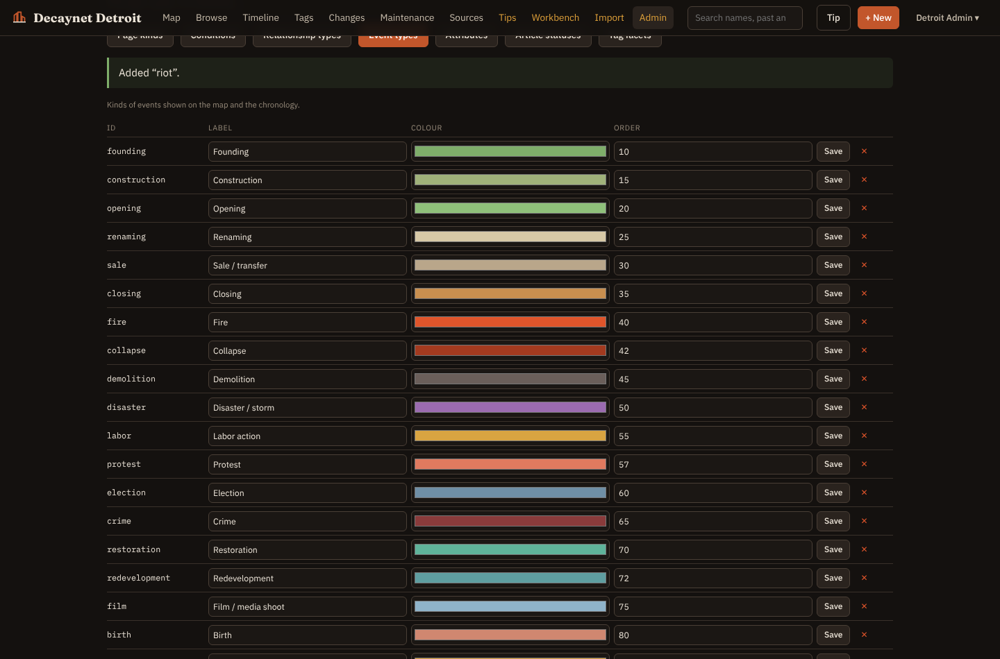
5. **Seed pages** for your area with [Import from OpenHistoricalMap & Wikidata](#starter-pages-from-openhistoricalmap--wikidata). Both cover the whole world. A downtown Detroit import, for example, proposed 967 pages: landmark buildings with architects, heights, styles and National Register numbers, plus streets, rail, events and businesses.

   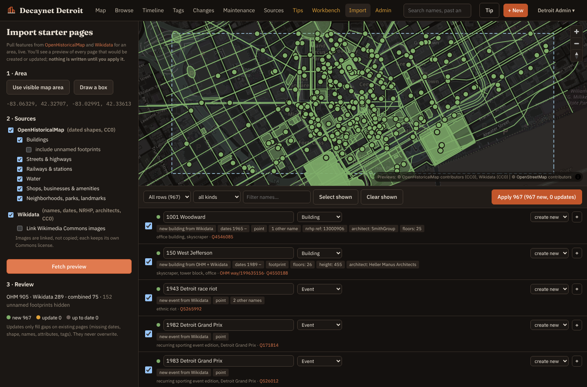
6. **Add your own eras and topics** on the Tags page (e.g. *Era › Arsenal of Democracy*), then start writing.

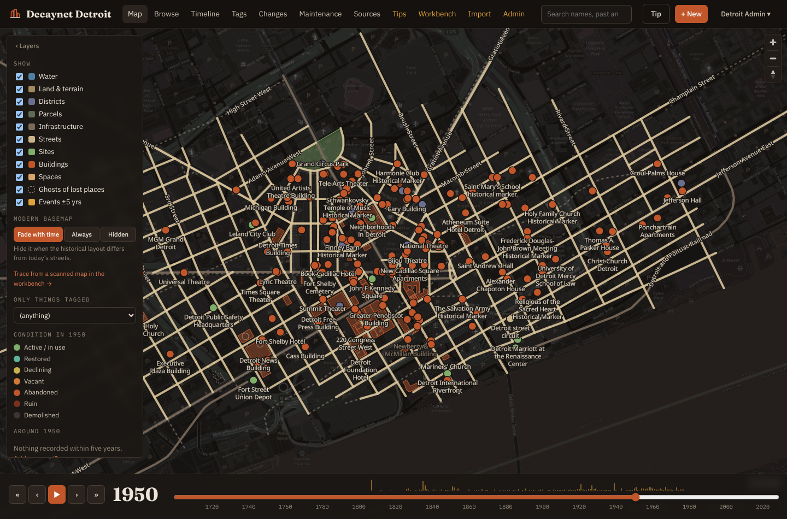

At country or world scale, the map only fetches what's in view (plus a margin) as you pan, so it stays fast however much has been mapped.

## Guides

### Reading the map

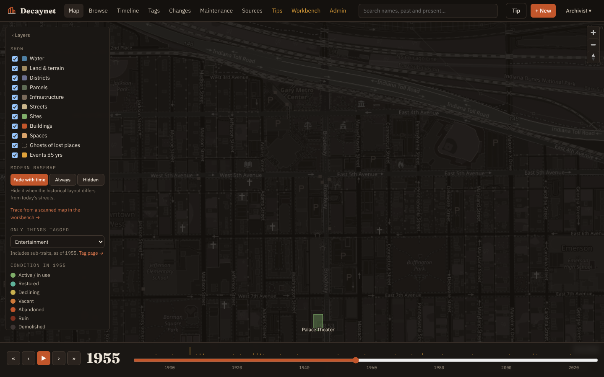

- **Year slider:** drag it, use ←/→ (Shift for a decade), or press ▶ to play history forward. The amber ticks above the slider show when things happened.
- **Click anything** to see it *as of that year*: its name then, its condition, address, tenants, connections and photos. Links in the panel jump to other pages at the same year.
- **Colours** show condition: green for active, amber for declining or vacant, rust for abandoned, dark red for ruin. *Ghosts* (dashed outlines) are places already gone by the chosen year.
- **Layers panel:**
  - toggle kinds (streets, buildings, spaces, water…);
  - choose how the modern basemap behaves (*fade with time*, *always*, *hidden*);
  - filter to things carrying a tag, including its sub-traits.
- **Events ±5 years** appear as glowing dots and in a list. Things fade with distance in time.
- **Share a view:** the URL keeps the year, selection, map position and tag filter, for example `/?y=1955&sel=…&c=-87.338,41.601,15.4&tag=entertainment`.
- **Search** matches historic names too: "Genesis Towers" finds Hotel Gary. It also finds street addresses: "577 Washington St" lists the buildings at that address, links to their pages and jumps to them on the map. Addresses the wiki doesn't know yet are geocoded from OpenStreetMap, with a *Create a page here* shortcut that carries the address and map point onto the new page.

### Adding and editing pages

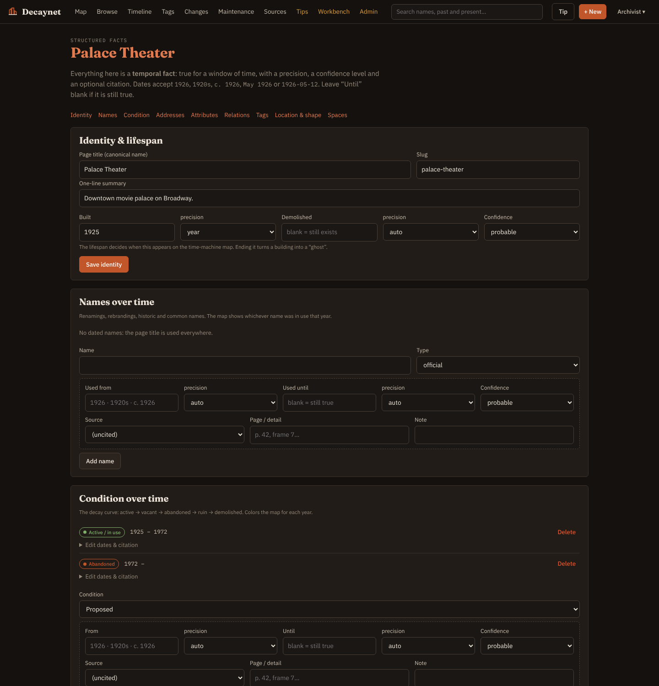

1. **Create a page** with **+ New**. Pick its kind (building, street, business, person, event…), a name, and when it began and ended. Optionally drop a point on the map.
2. **Add facts** on the page's **Edit facts** screen. Every fact has its own time window:

   | Section | Examples |
   |---|---|
   | Names over time | "Hotel Gary" 1927–1970s, then "Genesis Towers" |
   | Condition over time | Active 1926–1975 → Abandoned → Ruin (1990s) |
   | Addresses | 577 + *Washington Street* (linked to the street page, so it follows renamings) |
   | Attributes | Architectural style, floors, construction cost, population… |
   | Relations | *occupied by*, *owned by*, *designed by*, *happened at*, *depicts*… with qualifiers like `office=Mayor` |
   | Tags | *Business type › Entertainment › Movie theater*, dated if the use changed |
   | Location & shape | Footprints, centerlines, boundaries; a new shape when it moved or grew |

3. **Dates can be fuzzy.** Type them the way historians write them:

   | You type | Stored as |
   |---|---|
   | `1926` | the year 1926 |
   | `1920s` | the decade, so it counts for all of 1920–1929 |
   | `c. 1926`, `1926?` | 1926, marked *approximate* |
   | `May 1926`, `1926-05` | the month |
   | `May 12, 1926`, `1926-05-12` | the day |

   Leave **Until** blank if something is still true.
4. **Cite it.** Pick a source on any fact, with a page or frame number, or choose *+ New source…* to create one right there for that page. In an article, the **Cite** button inserts a numbered footnote the same way. Sources used across many pages (a city directory, a Sanborn atlas) belong in the shared library on the **Sources** page; a page's own source can be shared later with *Add to library*. Mark uncertain facts *approximate*, *speculative* or *disputed*.
5. **Write the article** with **Edit article** (Markdown). Link pages with `[[slug]]` or `[[slug|label]]`; links to pages that don't exist yet show red. Set the article status (stub → draft → needs sources → needs review → good) and add an edit summary.
6. **Add media** with **+ Media**. A photo has three dates: when it was taken, the period it shows, and when it was added. You can also mark where the camera stood.

### Wrong kind? Duplicate as another kind

Imports and quick edits sometimes get the kind wrong: a "building" that is really the business inside it, a site that is a building, an event created as a place. *More → Duplicate as another kind…* makes a **new page** of the right kind next to the original and copies everything that fits: name, summary, lifespan, other names, tags, facts that apply to the new kind, links, the article (as its first revision) and the sources made for the page (citations point at the copies). **The original isn't changed**; review the copy, then delete the original or keep both.

When a place becomes an occupant (building → organization, person or event), its footprint, addresses, conditions and place links stay with the place, and the new page is linked to it: it *occupies*, *lived at* or *happened at* the original for its lifespan. An occupant becoming a place is linked the other way. Map and Wikidata ids stay with the original, since each belongs to one page. Media pages can't be duplicated as another kind.

### Private pages (drafts)

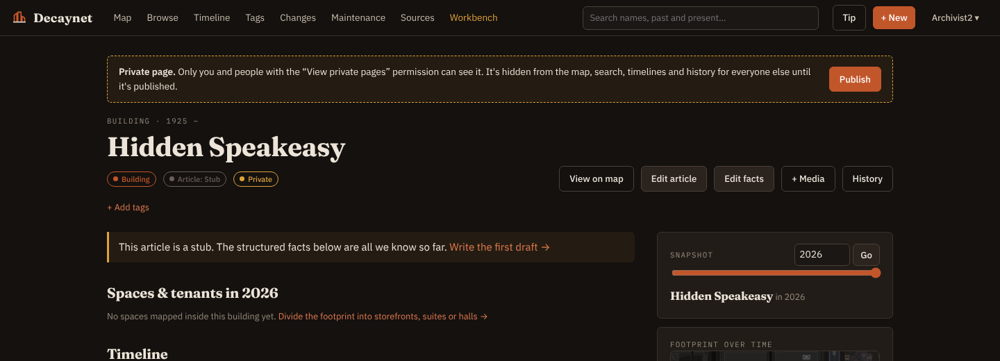

A page can be **private**: hidden from the public until it's ready. Use this for half-researched buildings, sensitive stories still being checked, or a batch of imported pages you want to review first.

- **Who can see it:** the person who created it, and roles with the **View private pages** permission (contributors and up by default; change it in *Roles & permissions*).
- **Everyone else sees nothing.** The page returns *not found*, and it's left out of the map, search, browse, the timeline, recent changes, connections from other pages and the REST API. This is enforced by row-level security in the database, not just hidden in the UI. Its article, facts, tags, shapes and history are hidden along with it.
- **Making a page private:**
  - tick *Keep private until it's ready* when creating it;
  - use **Make private** on the page or the checkbox in *Edit facts*;
  - tick *new pages private* when applying an import.
- **Publishing:** click **Publish** on the private-page banner. The page goes live and `published_at` is stamped.
- **Default for new pages:** *Admin → Site settings → Accounts → New pages start private*. This applies to pages created by hand, from media uploads, tips, the workbench and imports.
- **Finding drafts:** *Maintenance → Private drafts awaiting publication*, or *Browse → Visibility: private drafts*.

Responses that can include private pages are sent with `Cache-Control: private, no-store`, so a shared cache or CDN never serves them to the public. One limit: uploaded media files live in a public storage bucket under unguessable paths. A private media page and its metadata are hidden, but anyone who already has a file's direct URL can still open it.

### Buildings, spaces and tenants

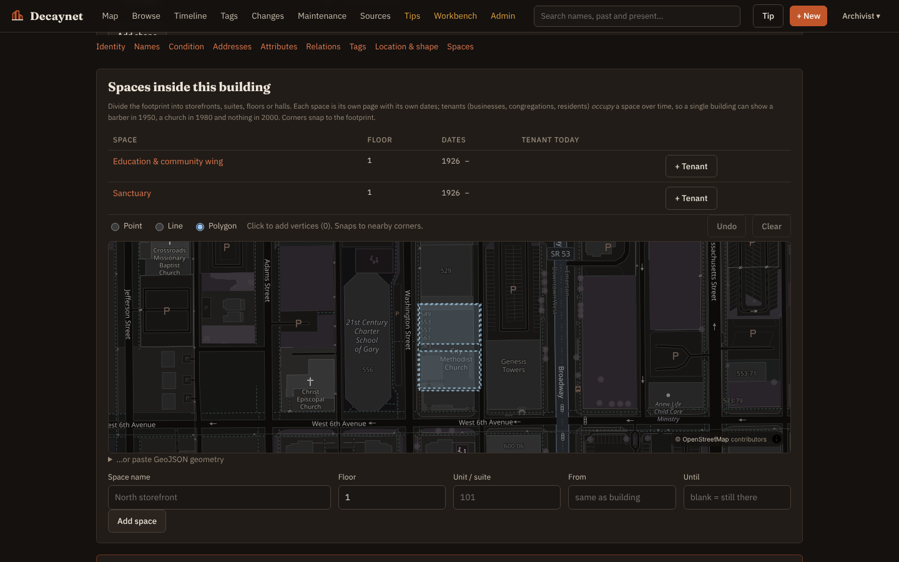

Buildings are polygons, not dots. To record who occupied which part:

1. Give the building a **footprint**: trace it in the workbench, or draw it under **Edit facts → Location & shape**.
2. Under **Edit facts → Spaces**, draw each storefront, suite or hall *inside* the footprint. Corners snap to the footprint, and a space that pokes out more than 2 m is rejected.
3. Click **+ Tenant** on a space to add who occupied it and when (a business, a congregation, a resident).

On the building's page you'll see a floor plan and a "tenant in YEAR" table. On the map, zoom past ~16 to see spaces labelled with their tenants. Tagging a tenant (say *Food & drink*) lights up the space it occupied when you filter the map by that tag.

### Tracing from a scanned map (workbench)

The **workbench** lays a Sanborn fire-insurance sheet, an old plat or an aerial photo over the live data, so you can line things up and trace from it.

> **Scans are session-only drawing aids.** The image is opened straight from your computer and never uploaded, stored or shown to anyone else. It disappears when you close the page. Only the shapes you trace are saved.

| 1. Pin the scan | 2. Compare | 3. Trace |
|---|---|---|
| 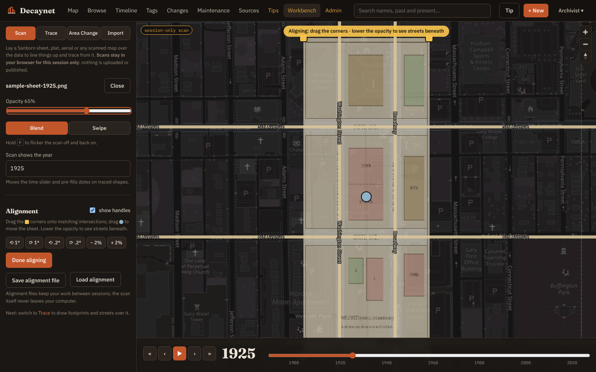 | 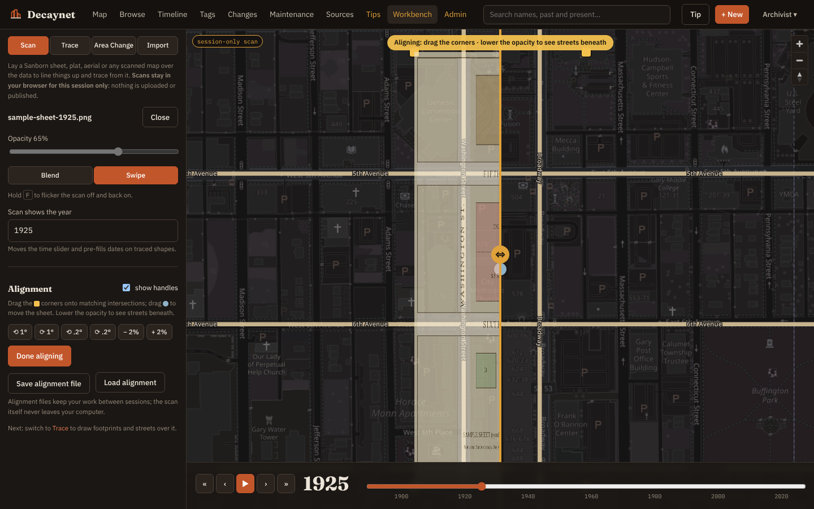 |  |

*(The sheet in these screenshots is a synthetic sample, not a real Sanborn map.)*

1. **Workbench → Scan → Open a scan** (JPG/PNG). It appears over the map with four yellow corner handles.
2. **Align it**, either way (switch under *Alignment*):
   - **Drag corners:** drag each corner onto the matching street intersection; drag the blue centre handle to move the whole sheet. Use the ⟲/⟳ and ±2 % buttons for fine rotation and scale, and lower the opacity to see the streets underneath.
   - **Match pins:** the scan opens in its own pane beside the map. Click a recognisable spot on the scan (a street corner, a church), then click the same spot on the map (map clicks snap to existing shapes); repeat. Two pins move, turn and scale the sheet into place; three or more also correct stretch and skew. Spread pins toward the edges of the sheet. Drag any pin on either side to fine-tune; with more pins than the fit needs, each pin shows how many metres off it is, so a misplaced one stands out. <kbd>Backspace</kbd> removes the last pin.
3. **Compare** in *Blend* or *Swipe* mode, or hold <kbd>F</kbd> to flicker the scan off and on.
4. Enter the **year the scan shows**. This moves the time slider and pre-fills dates on what you trace.
5. Switch to **Trace**:
   - Click to place vertices; they snap to existing corners. <kbd>Backspace</kbd> undoes and <kbd>Esc</kbd> clears.
   - Then either attach the shape to an existing page or create a new page (building, street, parcel…).
   - Pick a condition, a role (*footprint*, *centerline*…), dates and a citation.
   - Or skip the page entirely: under **Export** (at the top of the Trace tool), **Download** saves the shape as a `.geojson` file and **Copy** puts it on the clipboard (lon/lat, with the name, kind, role and year as properties). **Keep & draw another** sets shapes aside so you can export several at once with **Download all** / **Copy all**. Kept shapes live only in that browser tab.
6. **Save alignment file** downloads the corner positions (and any pins) as a small JSON file. Next time, open the same scan and choose **Load alignment** to pick up where you left off. The scan itself never leaves your computer.

Already georeferenced a sheet elsewhere (Map Warper, Allmaps…)? Paste its XYZ tile URL under **…or a tile layer**. It's also session-only.

### When a whole area's layout changed

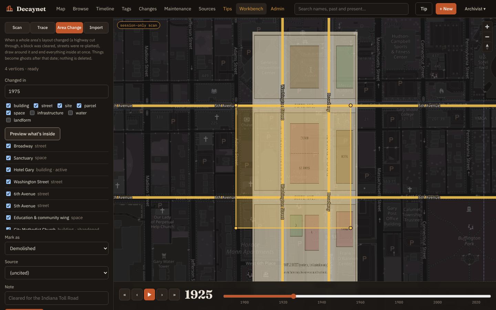

The modern grid is a poor guide to the past. The lakefront was filled for the mill, the Grand Calumet River was re-channelled, the Toll Road and urban renewal erased blocks, and streets were vacated and re-platted. Decaynet handles this in several ways:

- **Everything has dated geometry.** Streets, parcels, shorelines (`water`) and terrain (`landform`) can each carry several shapes over time.
- **Ended things become ghosts.** You can still see the old grid after it's gone.
- **The basemap can be hidden** (Layers → Modern basemap → *Hidden*, or as the site default) when today's streets mislead.
- **The Area change tool:** draw around a cleared block or highway corridor, enter the year, preview everything standing inside, untick anything that survived, and end the rest in one step, with a condition (demolished / vacated…), a note and a citation. Nothing is deleted; it just becomes history.
- Then **trace the new layout** from a later scan or import it.

### Importing GIS data

**Workbench → Import** accepts a GeoJSON FeatureCollection in lon/lat (EPSG:4326), for example footprints from a city GIS, digitized parcels or a street grid.

1. Choose the file. Features are previewed in blue.
2. Pick the kind and role, which property holds the **name**, and optionally which properties hold the **start** and **end year** (e.g. `built`, `razed`).
3. Set default dates, a condition, a confidence level and a source.
4. **Import.** Each feature becomes a page with a dated shape.

Bulk tools (area change and import) need the *Bulk map tools* permission.

### Starter pages from OpenHistoricalMap & Wikidata

Rather than copying data across by hand, **Import** (needs *Bulk map tools*) pulls features **live** from
[OpenHistoricalMap](https://www.openhistoricalmap.org) and [Wikidata](https://www.wikidata.org) for an area you choose.
OpenHistoricalMap supplies dated footprints, streets, rail and water through its public Overpass API. Wikidata supplies names, inception and demolition dates, NRHP numbers, architects, styles and aliases through its SPARQL service. Both are CC0.


1. **Pick an area:** *Use visible map area*, or *Draw a box* by clicking two corners. Keep it to a few blocks or a neighborhood (about 10 km across at most).
2. **Choose sources and categories:** buildings (optionally including unnamed footprints), streets, railways, water, businesses, and neighborhoods/landmarks; Wikidata, optionally linking Commons images.
3. **Fetch preview.** The server queries both services, then:
   - **pairs them up:** an OHM feature tagged `wikidata=Q…`, a Wikidata point inside an OHM footprint, or a similar name close by. An unnamed OHM footprint can get its name from Wikidata this way.
   - **groups** street segments that share a name into one street;
   - **matches** each result against existing pages, by previous import ID, Wikidata ID, overlapping footprint, or a similar name nearby of a compatible kind.
4. **Review.** Every row shows exactly what would happen:
   - **new** (green): the page that would be created, with its dates, shape, names, attributes and tags;
   - **update** (amber): only the *gaps* it would fill on an existing page (missing dates, a shape if the page has none, new names, attributes it lacks, tags, links). Existing facts are **never overwritten**;
   - **up to date** (grey): already imported, nothing to add.

   You can rename, change the kind, switch a row between create, update and skip, opt into adding a second shape, filter, and click ⌖ to see a feature on the map.

   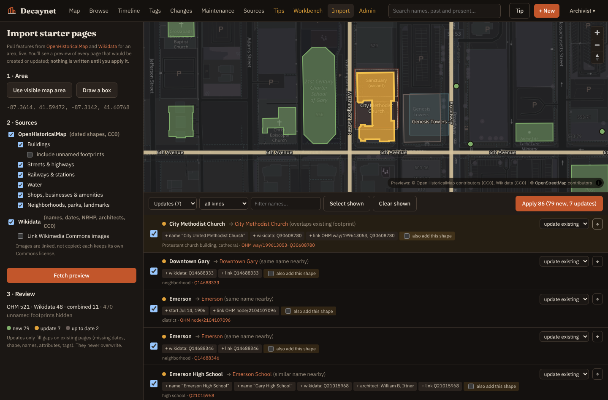
5. **Apply.** After a confirmation, everything is written in one transaction. Each fact is cited to an auto-created source ("OpenHistoricalMap, retrieved DATE" / "Wikidata, retrieved DATE"), and each page keeps a link to its OHM element or Wikidata item, so the next import recognises it instead of duplicating it.
6. **Undo** (moderators): *Recent imports* can delete the pages an import created. Additions it made to existing pages stay, and show up in the change log.

Notes:
- An OHM `end_date` sets the end of the page's lifespan, which turns it into a ghost on the map. It does **not** add a "demolished" condition, because the source doesn't say how something ended.
- OHM's public Overpass server allows only a couple of queries at a time per IP. The app retries politely, and re-previewing the same area within 10 minutes reuses the fetched data (matching is always re-run).
- Both services ask for a descriptive User-Agent; the app sends your site name and source URL.

### Anonymous tips

| Guest | Reviewer |
|---|---|
|  | 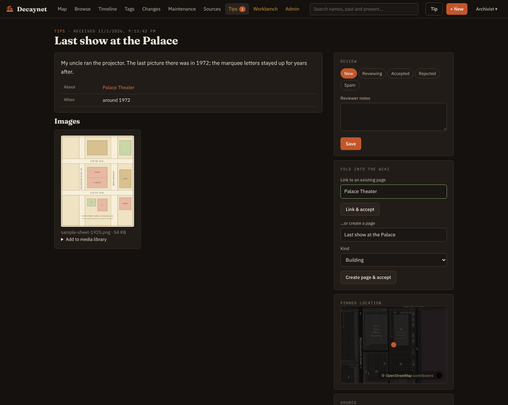 |

**For visitors:**
- Anyone can open **Tip** in the header, with no account needed.
- They can say what a tip is about (an existing page or free text), roughly when, and optionally leave contact details, pin a location and attach photos.
- Large photos are resized in the browser before sending.

**For reviewers** (*Review tips* permission):

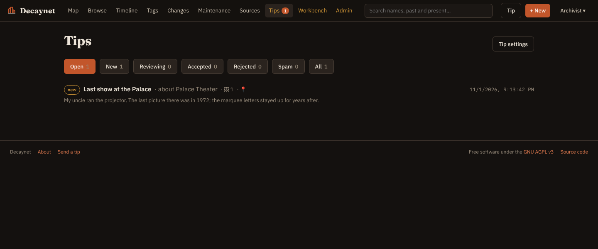

- Open **Tips**. The header badge counts open tips.
- Move tips through **new → reviewing → accepted / rejected / spam** and add private notes.
- **Link** a tip to an existing page, or **create a page** from it (a pinned location becomes a *speculative* point).
- **Add to media library**: copy a tip photo into public media as *depicting* a page. Rights are marked "unverified" until you set them.
- The **Source** box shows whether a captcha was passed, the IP (if the site records full IPs) and how many tips came from the same source.

Tips are written only by the app server, after the captcha, rate-limit and honeypot checks, so nobody can bypass them through the API. Photos go to a **private** storage bucket that reviewers read through short-lived signed links.

### Administration

*Admin* opens an **Overview** of what needs attention (timelines to review, open tips, unpublished drafts) and links to every admin section you have access to. Staff with more than one tool (Tips, Workbench, Import, Admin) find them under a single **Tools** menu in the header. On a page, the main actions stay as buttons; History, Add media, Make private and the moderator tools (Clean up timeline, Lock article, Delete page) are under **More**.

**Site settings** (*Admin → Site settings*) replaces config files:

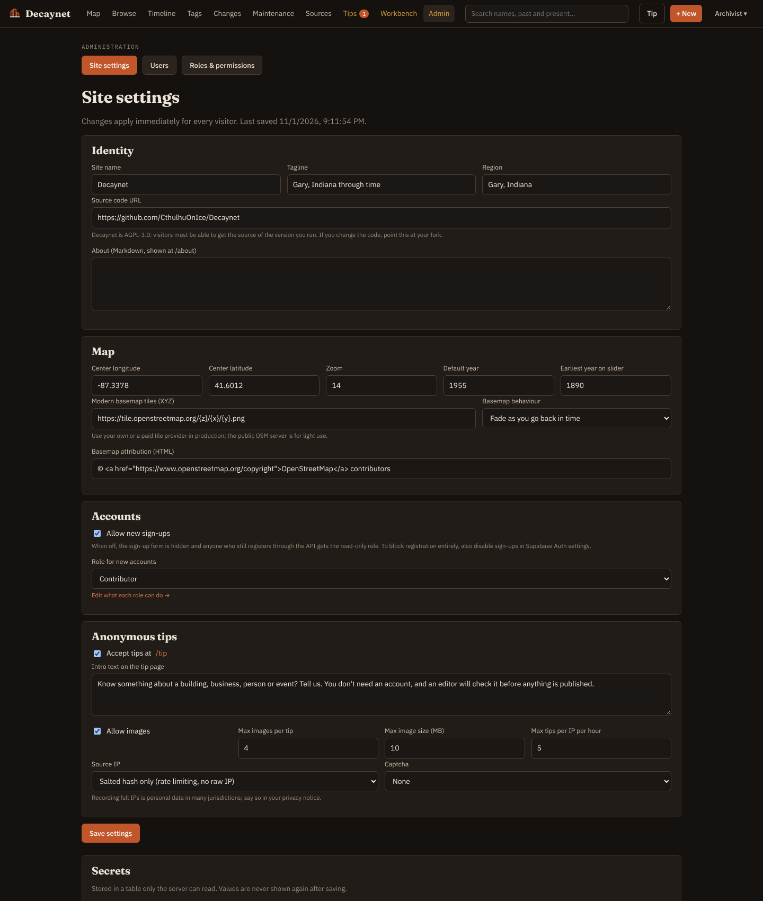

| Section | Settings |
|---|---|
| Identity | Site name, tagline, region, **source code URL** (see [License](#license)), About page text |
| Map | Default centre, zoom and year; earliest slider year; basemap tiles, attribution and fade behaviour |
| Accounts | Allow sign-ups; role given to new accounts |
| Tips | On/off, intro text, images (count and size), **IP mode**, **captcha**, rate limit |
| Secrets | Captcha secret key, IP-hash salt. Stored where only the server can read them, and never shown again |

**Tip privacy options:**
- **IP mode** `off`: nothing recorded, and no rate limiting.
- **IP mode** `hash` (the default): a salted one-way hash is kept for rate limiting only; nobody can read the IP.
- **IP mode** `full`: the IP is stored and shown to reviewers. Mention this in your privacy notice.

**Captcha setup:**
- **Cloudflare Turnstile:** create a widget, paste the *site key* in settings, paste the *secret key* under Secrets, then choose *Turnstile*.
- **hCaptcha:** the same steps with an hCaptcha site key and secret.

**Roles & permissions** (*Admin → Roles & permissions*):

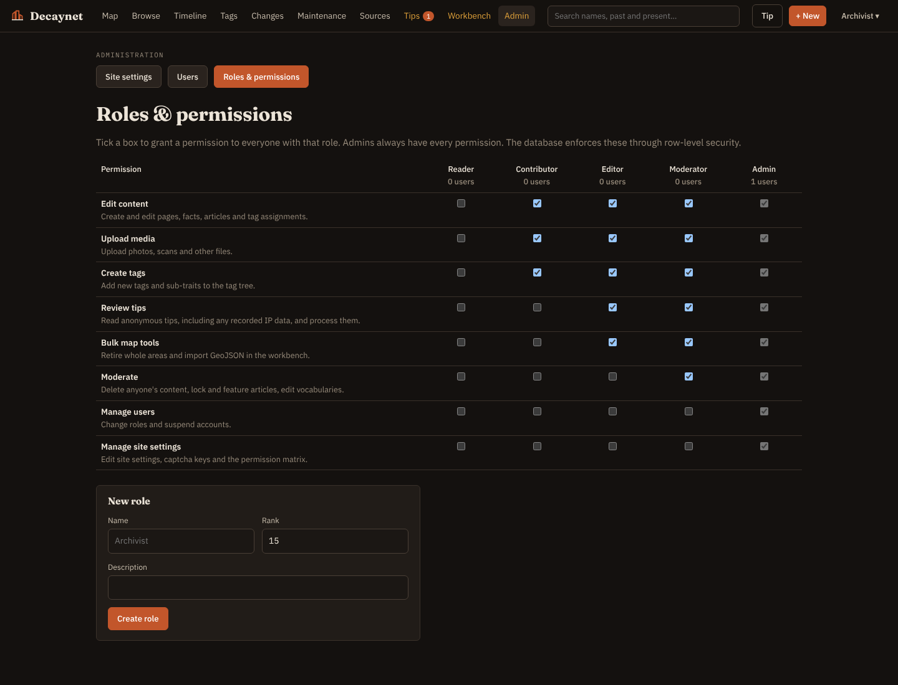

Tick a box to grant a permission to a role, and add your own roles (e.g. "Archivist"). The database enforces the matrix through row-level security, so it holds even if someone calls the API directly. Defaults:

| Permission | Contributor | Editor | Moderator | Admin |
|---|:-:|:-:|:-:|:-:|
| Edit content (pages, facts, articles, tags on pages) | ✓ | ✓ | ✓ | ✓ |
| View private pages (drafts not yet published) | ✓ | ✓ | ✓ | ✓ |
| Upload media | ✓ | ✓ | ✓ | ✓ |
| Create tags | ✓ | ✓ | ✓ | ✓ |
| Review tips | | ✓ | ✓ | ✓ |
| Bulk map tools (area change, import) | | ✓ | ✓ | ✓ |
| Moderate (delete others' content, lock & feature articles) | | | ✓ | ✓ |
| Clean up timelines (review and apply timeline fixes) | | | ✓ | ✓ |
| Manage users | | | | ✓ |
| Manage site settings | | | | ✓ |

**Users** (*Admin → Users*):
- Change roles and suspend accounts. Suspended users can still read.
- Email addresses appear here when `SUPABASE_SERVICE_ROLE_KEY` is set.
- The last admin can't be demoted or suspended.

Everyone can manage their own profile, email and password at **Account**.

### Keeping quality up

| | |
|---|---|
| 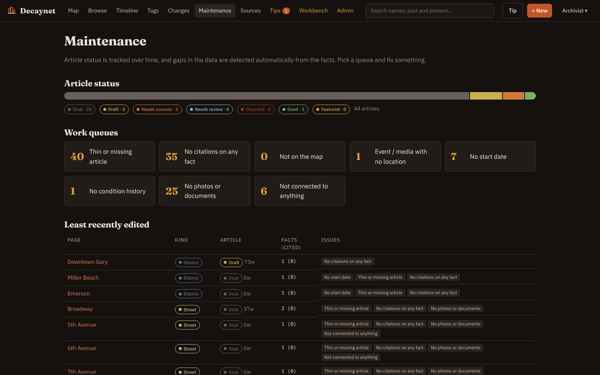 | **Maintenance** shows article status counts and work queues computed from the data: not on the map, no citations, no photos, thin article, no condition history, not connected to anything. |
| 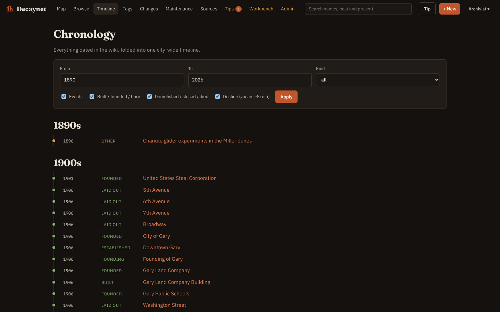 | **Timeline** is a city-wide chronology by decade: events, things built and demolished, and decline milestones. |
| 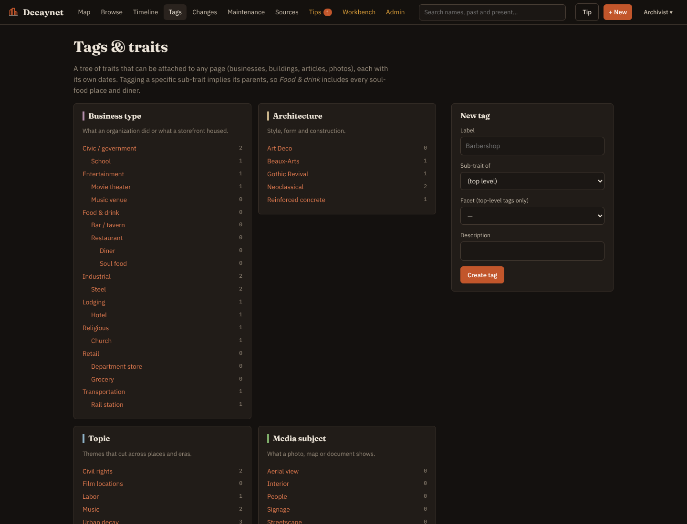 | **Tags** shows the trait tree with usage counts. Contributors can add sub-traits as they tag. |

**Timeline cleanup** (*Admin → Timelines*, or *More → Clean up timeline* on a page). Facts arrive one at a time from many tools, so timelines collect loose ends: *Active* still open after *Abandoned* starts, a building with no condition at all, an undated point that reads as "always there", a tenant still listed after the building was demolished. The cleanup reads the page as a whole and proposes the edits that make it one continuous story within its lifespan:

| Section | What it does |
|---|---|
| Lifespan | Ends it at a recorded demolition. *Suggests* a start from the earliest dated fact, or moving the end to a demolition date that disagrees with it |
| Conditions | One chain from start to end: *Active* when nothing is recorded or before the first recorded condition (e.g. before abandonment); gaps carried forward; overlaps closed; repeats merged; clipped to the lifespan; *Demolished* (*Vacated* for streets) added when the lifespan ends without one. *Suggests* removing conditions recorded after the end |
| Shapes | One footprint, point or line covers the whole lifespan; redrawn ones follow each other |
| Addresses | A single address covers the building's lifespan; several (corner buildings) are kept within it |
| Names, facts | Official renamings follow each other; dated names and facts stay within the lifespan |
| Relations, spaces | Tenants, owners and locations end when either side does; storefronts and suites end with their building |

Fixes are ticked by default; suggestions are not. Dates are compared at their precision, so "until 1949" followed by "from 1950" is continuous, not a gap. Some things need a person and are only listed: several undated conditions, footprints that start together (wings drawn separately), a fact entirely outside the lifespan. Added conditions are marked *approximate* with a note, and every edit goes through the page history.

**Changes** lists every edit to prose and facts. Each page's **History** shows its revisions, every fact change and its article status transitions.

---

## How the data model works

Most wikis store pages. Decaynet stores **entities, components and time**, and pages are views over them.

| Layer | What it is | Tables / functions |
|---|---|---|
| **Entities** | Just an id, a kind, a slug and a lifespan | `entities` |
| **Components** | Narrow tables, one per kind of fact | `entity_names`, `entity_geometries`, `entity_states`, `entity_attributes`, `addresses`, `relations`, `entity_tags` |
| **Systems** | SQL functions that fold facts into an answer *as of a date* | `map_snapshot`, `entity_snapshot`, `entity_timeline`, `chronology`, `moments_near`, `building_spaces`, `tags_at`… |

**Every fact is temporal.** All component tables share one header (`LIKE internal.temporal_fact`):

```
valid_from, valid_from_precision   -- 1926 · 1920s · May 1926 · 1926-05-12
valid_to,   valid_to_precision     -- blank = still true
valid  (generated daterange)       -- the window, widened to its precision
confidence                         -- confirmed · probable · approximate · speculative · disputed
source_id, source_detail, note     -- citation + "p. 42"
```

- **Fuzzy windows:** "active until 1975" at year precision stays true for all of 1975. When facts overlap, the one that started most recently wins.
- **Nothing is overwritten.** A renaming adds a name row, a fire adds a condition row, and a move adds a geometry row.
- **Two clocks:** *valid time* (when it was true on the ground) lives on the facts; *record time* (when someone wrote it down) lives in `change_log` and `article_revisions`.
- **Building → space → tenant:** spaces are entities `part_of` a building, with polygons inside its footprint; tenants `occupy` spaces.
- **Tags** form a tree inside facets; tagging a sub-trait implies its ancestors, and tag assignments are dated.
- **Permissions:** every RLS policy calls `has_permission()`, which reads the roles × permissions tables.
- **Visibility:** `entities.is_private` hides a page and, through `entity_hidden()` in each table's read policy, everything attached to it. The SQL systems run as the caller, so map snapshots, search and timelines respect it automatically.

Key RPCs:

| Function | Returns |
|---|---|
| `map_snapshot(at, kinds, bbox, ghosts, tag)` | GeoJSON of everything standing on a date (and ghosts), with names, condition and tenants as of then |
| `entity_snapshot(id, at)` / `entity_timeline(id)` / `entity_relations(id)` | One entity folded to a date / every fact in order / all edges with period-correct names |
| `moments_near(at, years)` / `chronology(from, to)` | Events and photos near a date / the city-wide chronology |
| `search_entities(q)` | Fuzzy search across current and historic names |
| `search_addresses(q)` | Fuzzy search across street addresses, with the linked page and a map point |
| `building_spaces(id, at)` / `add_space(...)` | Spaces and tenants of a building / validated space creation |
| `entities_in_area(...)` / `retire_area(...)` / `import_features(...)` | Workbench bulk tools |
| `match_import_candidates(...)` / `apply_import(...)` / `undo_import(...)` | OHM / Wikidata import: match, apply a reviewed plan, undo |
| `save_article(...)` / `set_article_status(...)` | Atomic revision + status transitions |

---

## Configuration reference

Almost everything is configured in the app: **Admin → Site settings** (identity, region, map, units, address format, language, sign-ups, tips, captcha) and **Admin → Vocabulary**. Environment variables cover only infrastructure:

**All-in-one stack (`docker-compose.yml`)**

| Variable | Purpose |
|---|---|
| `POSTGRES_PASSWORD`, `JWT_SECRET`, `ANON_KEY`, `SERVICE_ROLE_KEY` | Required. Generate with `generate-secrets` (see Quick start) |
| `ORIGIN` | Public URL of the site (default `http://localhost:3000`) |
| `SUPABASE_PUBLIC_URL` | Public URL of the Supabase gateway (default `http://localhost:8000`) |
| `SEED` | `1` loads the Gary demo into an empty database |
| `ADMIN_EMAIL`, `ADMIN_PASSWORD`, `ADMIN_NAME` | Create the first admin on start (only while the site has none) |
| `SETUP_TOKEN` | Fixed code for the `/setup` wizard (default: random, printed in the app logs) |
| `SMTP_HOST`, `SMTP_PORT`, `SMTP_USER`, `SMTP_PASS`, `SMTP_ADMIN_EMAIL`, `SMTP_SENDER_NAME`, `MAILER_AUTOCONFIRM` | Email for auth |
| `PORT`, `KONG_HTTP_PORT`, `POSTGRES_HOST_PORT` | Published ports (3000 / 8000 / 5432) |
| `DECAYNET_IMAGE`, `DECAYNET_MIGRATE_IMAGE` | App / migrator images (default `ghcr.io/cthulhuonice/…:latest`) |
| `SUPABASE_POSTGRES_IMAGE`, `SUPABASE_AUTH_IMAGE`, `SUPABASE_REST_IMAGE`, `SUPABASE_STORAGE_IMAGE`, `SUPABASE_KONG_IMAGE` | Override Supabase images |
| `ADDRESS_HEADER`, `XFF_DEPTH` | Real client IPs behind a reverse proxy |
| `NODE_IMAGE`, `PG_IMAGE` | Base images when building with `docker-compose.build.yml` |
| `JWT_EXP` | Access-token lifetime in seconds (default 3600) |

**External Supabase (`docker-compose.external.yml`, or `npm run dev`)**

| Variable | Purpose |
|---|---|
| `PUBLIC_SUPABASE_URL`, `PUBLIC_SUPABASE_ANON_KEY` | Supabase URL and anon key as browsers reach them |
| `SUPABASE_SERVICE_ROLE_KEY` | Server-only. Needed for anonymous tips and for emails in user admin |
| `SUPABASE_INTERNAL_URL` | How the server reaches Supabase, if different from the public URL |
| `ORIGIN`, `ADDRESS_HEADER`, `XFF_DEPTH`, `BODY_SIZE_LIMIT`, `PORT`, `HOST` | Standard SvelteKit adapter-node settings |
| `DATABASE_URL`, `SEED` | For the migration runner |
| `ADMIN_EMAIL`, `ADMIN_PASSWORD`, `ADMIN_NAME`, `SETUP_TOKEN` | First admin (see [First admin](#first-admin)); needs the service-role key |

## Project layout

```
Dockerfile                       app image (adapter-node) + migration runner image
docker-compose.yml               all-in-one: app + self-hosted Supabase (Portainer-ready, no mounts/builds)
docker-compose.build.yml         override to build the app/migrator images from this checkout
docker-compose.external.yml      app + migrator against an existing Supabase
.github/workflows/docker.yml     builds and publishes the images to GHCR (amd64 + arm64)
docs/generate-secrets.html       offline, in-browser secrets generator
docker/migrate.sh                idempotent migration runner (Supabase-compatible history)
docker/generate-secrets.mjs      generates the database password, JWT secret and API keys
supabase/migrations/             0001 foundation · 0002 components · 0003 articles · 0004 systems
                                 0005 security/audit/storage · 0006 vocabulary · 0007 tags
                                 0008 permissions/settings · 0009 tips · 0010 spaces/layout tools
                                 0011 session-only overlays + source link · 0012 external ids & import
                                 0013 region-agnostic settings (units, address format, language, bounds)
                                 0014 private pages (visibility enforced by RLS)
supabase/seed.sql                optional Gary, Indiana demo (settings, pages, eras)
src/lib/map/style.ts             MapLibre layers for snapshots, ghosts, spaces, moments
src/lib/components/              TimeMachineMap, YearSlider, EntityPanel, Timeline, MiniMap,
                                 GeometryPicker, EntityPicker, TemporalFields, TagSelect, TagChips…
src/lib/server/                  db helpers, forms, markdown, service client, tips (captcha/IP)
src/lib/server/importers/        OpenHistoricalMap (Overpass) + Wikidata (SPARQL) fetch, combine, match, plan
src/routes/                      pages, /api endpoints, /workbench, /import, /tip(s), /admin
docs/images/                     screenshots used in this README
ROADMAP.md                       long-horizon tracker
```

---

## About the demo data

The demo is **optional**: an install without it starts as an empty, neutral site. With it (`SEED=1`), the site is configured for Gary, Indiana and has about 45 pages to show how the model works: Union Station, City Methodist, Hotel Gary / Genesis Towers, City Hall, the Palace, Emerson School, the Aquatorium, Gary Works, the 1919 steel strike, Mayor Hatcher and others.

- **Coordinates and shapes are approximate placeholders.** Building footprints are rectangles of plausible size, the spaces inside City Methodist and the Palace are schematic, and the lake shoreline and Grand Calumet River course are rough. All of them are flagged *approximate* or *speculative*.
- **Dates come from commonly cited public histories**, and uncertain ones are flagged. Several articles are deliberately marked *Needs sources*.
- The Maintenance page lists everything that still needs a citation, a photo or a traced footprint. Good primary sources:
  - the Calumet Regional Archives (IU Northwest)
  - Sanborn maps
  - city directories
  - the Post-Tribune and the Gary American

---

## Roadmap & contributing

The long-horizon plan, open questions and decision log are in **[ROADMAP.md](ROADMAP.md)**. Pull requests should:

1. add new SQL as a **new migration** (never edit an applied one),
2. pass `npm run check`,
3. keep the [data model](#how-the-data-model-works) rule: facts are temporal rows, and systems are SQL.

---

## License

Copyright © 2026 the Decaynet contributors.

This program is free software: you can redistribute it and/or modify it under the terms of the **GNU Affero General Public License** as published by the Free Software Foundation, either version 3 of the License, or (at your option) any later version. It is distributed in the hope that it will be useful, but **without any warranty**; without even the implied warranty of merchantability or fitness for a particular purpose. See [LICENSE](LICENSE) for the full text.

**If you run Decaynet for others over a network, AGPL §13 requires you to offer them the source of the version you run.** The site footer, the About page and the map attribution link to the **Source code URL** in *Admin → Site settings*. If you modify the code, point that URL at your fork.

Content contributed to a Decaynet site (articles, facts, media) is separate from the software and is governed by that site's own terms. Map data © OpenStreetMap contributors (ODbL) where the modern basemap is shown. Imported OpenHistoricalMap and Wikidata data is CC0. Linked Wikimedia Commons images keep their own licenses.
